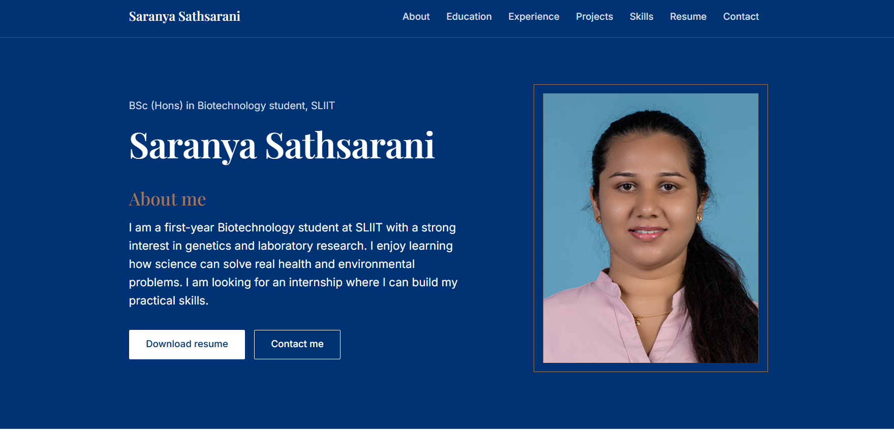
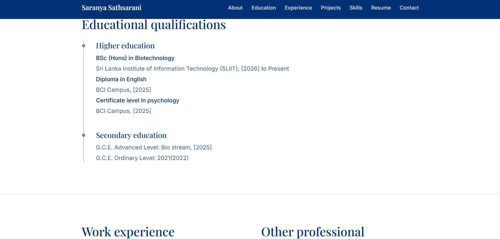
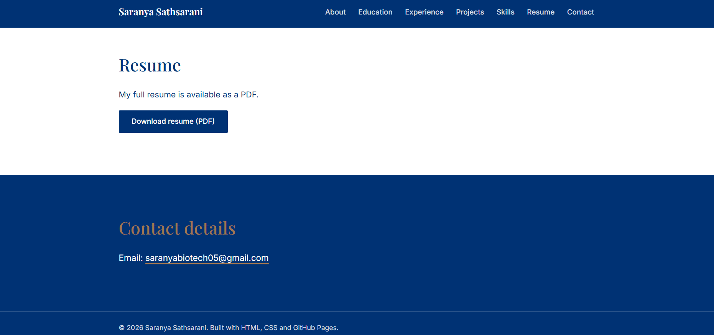

Saranya Sathsarani | E-Portfolio
Personal e-portfolio built for SC1172: Introduction to Information Technology
(BSc (Hons) in Biotechnology, SLIIT).
Live website: https://hs26510335.github.io/your_HS26510335.github.io/
About this project
This website presents my education, experience, projects, skills, hobbies and
contact details, with a downloadable PDF resume. It uses a minimal design with
a navy, white and tan colour palette.
Sections
About me
Educational qualifications
Work experience and other professional qualifications
Projects
Skills
Hobbies
Resume (PDF download)
Contact details
Technologies used
HTML5 for page structure
CSS3 for styling and responsive layout
Markdown for this documentation
GitHub and GitHub Pages for version control and hosting
Design
Item	Choice
Colours	Navy `#003274`, White `#ffffff`, Tan `#a27751`
Headings	Playfair Display
Body text, menu, buttons	Inter
Screenshots

Contact
Email: saranyabiotech05@gmail.com
